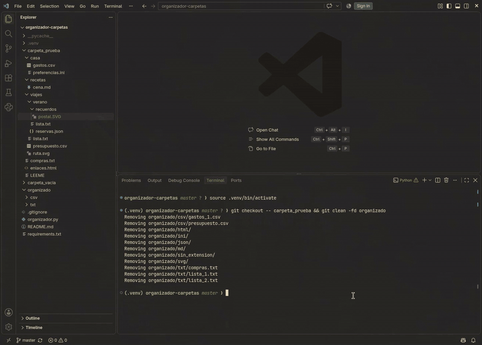
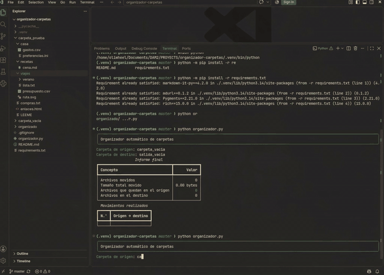
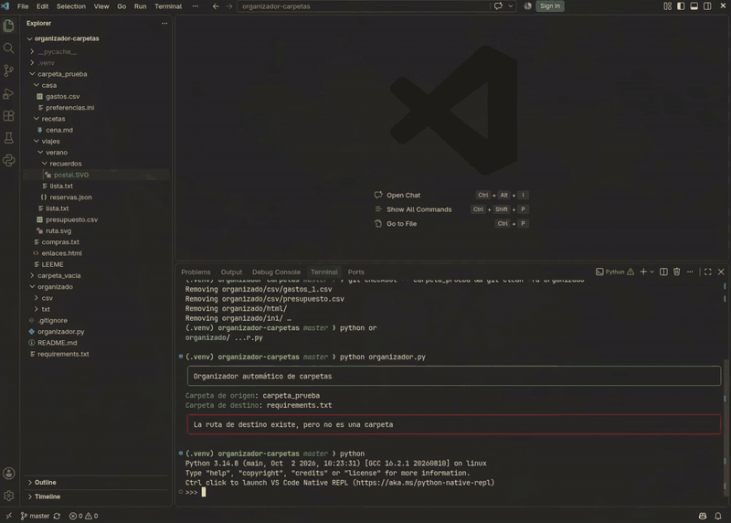

# Organizador automático de carpetas

Programa en Python que organiza los archivos de una carpeta y sus subcarpetas según su extensión. Mueve los archivos al destino indicado, evita sobrescrituras y muestra un informe en la terminal con Rich.

> **Importante:** los archivos se mueven, no se copian. Utiliza los ejemplos incluidos o una copia de tus datos. No uses la raíz del proyecto ni tu carpeta personal como origen.

## Vídeo de demostración

[Descargar el vídeo de demostración (MP4)](https://github.com/obiticadev/organizador-carpetas/releases/download/v1.0/organizador-carpetas_entrega.mp4)

El vídeo recoge la preparación del entorno, los casos de origen vacío, origen inexistente, destino dentro del origen y destino que es un archivo, las pruebas de `tamano_legible()` y la clasificación válida con el estado inicial y final de las carpetas. También está disponible en la [release v1.0](https://github.com/obiticadev/organizador-carpetas/releases/tag/v1.0).

## Funcionalidades

- Recorrido recursivo de subcarpetas mediante funciones propias, sin `os.walk()`.
- Clasificación en carpetas por extensión en minúsculas, conservando el nombre original del archivo.
- Categoría `sin_extension` para los archivos sin extensión.
- Sufijos numéricos para evitar sobrescribir archivos: `lista_1.txt`, `lista_2.txt`, etc.
- Creación automática del destino al mover el primer archivo.
- Conservación de las carpetas vacías del origen.
- Comprobación de rutas inexistentes, tipos incorrectos y carpetas iguales o anidadas.
- Informe con archivos movidos, tamaño total, recuentos finales e historial numerado.

## Requisitos

- Python 3 y pip. Proyecto probado con Python 3.14.
- Dependencias de `requirements.txt`, incluida `rich==15.0.0`.

Los módulos `os` y `shutil` forman parte de Python y no requieren instalación adicional.

## Instalación

Abre una terminal en la raíz del repositorio.

### Linux y macOS

```bash
python3 -m venv .venv
source .venv/bin/activate
python -m pip install -r requirements.txt
```

### Windows (PowerShell)

```powershell
py -m venv .venv
.\.venv\Scripts\Activate.ps1
python -m pip install -r requirements.txt
```

En VS Code, selecciona el intérprete del entorno mediante **Python: Select Interpreter**.

## Uso

Con el entorno activado, ejecuta:

```bash
python organizador.py
```

Introduce las rutas de origen y destino cuando se soliciten:

```text
Carpeta de origen: carpeta_prueba
Carpeta de destino: organizado
```

<table align="center">
  <tr>
    <td align="center">
      
      <br>
      <sub><b>Clasificación válida</b> · <code>carpeta_prueba</code> → <code>organizado</code>: 12 archivos movidos, informe final e historial de movimientos.</sub>
    </td>
  </tr>
</table>

Las rutas relativas parten del directorio actual de la terminal. También se admiten rutas absolutas. Si una ruta contiene espacios, escríbela normalmente en la pregunta, sin añadir comillas alrededor.

El origen debe existir y ser una carpeta. El destino puede no existir, pero si existe debe ser una carpeta. No se permite que sean iguales ni que una carpeta esté dentro de la otra.

## Estructura del proyecto

```text
organizador-carpetas/
├── organizador.py       # Programa principal y funciones
├── requirements.txt     # Dependencias del entorno
├── README.md            # Documentación del proyecto
├── .gitignore           # Exclusiones del control de versiones
├── docs/img/            # GIFs de demostración del README
├── carpeta_prueba/      # Archivos y subcarpetas para las pruebas
├── organizado/          # Destino de ejemplo con archivos preexistentes
└── carpeta_vacia/       # Prueba de origen vacío; se crea localmente
```

El entorno `.venv/` y la caché `__pycache__/` se generan localmente y no se incluyen en Git. La carpeta vacía tampoco se conserva en Git.

## Estructura del código

| Función | Responsabilidad |
| --- | --- |
| `obtener_extension` | Obtener la extensión en minúsculas o `sin_extension`. |
| `tamano_legible` | Convertir bytes a bytes, KB, MB o GB con divisiones entre 1024. |
| `una_dentro_de_otra` | Comprobar si las rutas son iguales o están anidadas. |
| `nombre_disponible` | Buscar un nombre libre mediante un bucle `while`. |
| `clasificar_archivo` | Mover un archivo, registrar el movimiento y devolver su tamaño. |
| `clasificar_carpeta_recursivo` | Clasificar los archivos de todos los niveles y sumar sus bytes. |
| `contar_archivos_recursivo` | Contar los archivos de una carpeta y sus subcarpetas. |
| `mostrar_cabecera` | Mostrar el panel inicial. |
| `mostrar_informe` | Mostrar las tablas del resumen y de los movimientos. |
| `main` | Pedir las rutas, validarlas y coordinar el programa. |

Las operaciones sobre archivos no imprimen resultados. La presentación se realiza con un único objeto `Console`, creado en `main()` y pasado a las funciones de presentación.

La lista `historial` se comparte entre las llamadas y se modifica con `.append()`, sin devolverla. Los contadores son locales a cada llamada: las funciones recursivas devuelven sus resultados para sumarlos en la llamada anterior.

## Archivos de prueba

Se incluyen ejemplos ficticios de compras, viajes, recetas y gastos domésticos. Las imágenes SVG son archivos vectoriales válidos.

```text
carpeta_prueba/                  # 12 archivos iniciales
├── compras.txt
├── LEEME
├── enlaces.html
├── viajes/
│   ├── lista.txt
│   ├── presupuesto.csv
│   ├── ruta.svg
│   └── verano/
│       ├── lista.txt
│       ├── reservas.json
│       └── recuerdos/
│           └── postal.SVG
├── casa/
│   ├── gastos.csv
│   └── preferencias.ini
└── recetas/
    └── cena.md

organizado/                      # 2 archivos preexistentes
├── txt/
│   └── lista.txt
└── csv/
    └── gastos.csv
```

La estructura permite comprobar extensiones variadas, archivos sin extensión, tres niveles de subcarpetas, nombres repetidos y un destino con contenido previo.

### Clasificación válida

Usa `carpeta_prueba` como origen y `organizado` como destino. El resultado esperado es:

- **12 archivos movidos**, **0 archivos en origen** y **14 archivos en destino**.
- Las carpetas originales se conservan vacías.
- Los archivos preexistentes `organizado/txt/lista.txt` y `organizado/csv/gastos.csv` mantienen su contenido.
- Los dos `lista.txt` del origen quedan como `lista_1.txt` y `lista_2.txt`; el orden de asignación puede variar.
- El archivo nuevo `gastos.csv` queda como `gastos_1.csv`.
- `ruta.svg` y `postal.SVG` se agrupan en `organizado/svg`.
- `LEEME` se mueve a `organizado/sin_extension`.
- El tamaño mostrado corresponde solo a los archivos movidos, no a los que ya estaban en destino.

Una segunda ejecución con las mismas rutas y sin reponer archivos debe mostrar 0 movidos, 0 bytes y 14 archivos en destino.

### Casos límite

Crea una carpeta vacía llamada `carpeta_vacia`. Git no conserva directorios vacíos, por lo que deberá crearse de nuevo tras clonar el repositorio. En Linux/macOS:

```bash
mkdir -p carpeta_vacia
```

No añadas un `.gitkeep`: el programa lo contaría como un archivo.

Ejecuta `python organizador.py` para cada caso:

| Caso | Origen | Destino | Resultado esperado |
| --- | --- | --- | --- |
| Origen vacío | `carpeta_vacia` | `salida_vacia` (inexistente) | 0 movidos y 0 archivos en ambas rutas; el destino no se crea. |
| Origen inexistente | `carpeta_inexistente` | `organizado` | Aviso de error sin mover archivos. |
| Origen que es un archivo | `requirements.txt` | `organizado` | Aviso de origen inválido. |
| Destino que es un archivo | `carpeta_prueba` | `requirements.txt` | Aviso de destino inválido. |
| Rutas iguales | `carpeta_prueba` | `carpeta_prueba` | Aviso de rutas relacionadas. |
| Destino dentro del origen | `carpeta_prueba` | `carpeta_prueba/salida` | Aviso de rutas relacionadas. |
| Origen dentro del destino | `carpeta_prueba/viajes` | `carpeta_prueba` | Aviso de rutas relacionadas. |

Realiza primero los casos de validación y después la clasificación válida. Comprueba el estado de las carpetas antes y después de cada ejecución.

<table align="center">
  <tr>
    <td align="center">
      
      <br>
      <sub><b>Validación de rutas</b> · origen inexistente, destino dentro del origen y destino que es un archivo: aviso en rojo y fin sin traceback.</sub>
    </td>
  </tr>
</table>

### Pruebas de conversión de tamaños

Desde una sesión de `python`:

```python
from organizador import tamano_legible

tamano_legible(0)           # '0.00 bytes'
tamano_legible(1023)        # '1023.00 bytes'
tamano_legible(1024)        # '1.00 KB'
tamano_legible(1048576)     # '1.00 MB'
tamano_legible(1073741824)  # '1.00 GB'
tamano_legible(1536)        # '1.50 KB'
```

<table align="center">
  <tr>
    <td align="center">
      
      <br>
      <sub><b>Conversión de tamaños</b> · <code>tamano_legible()</code> con valores límite que cubren bytes, KB, MB y GB.</sub>
    </td>
  </tr>
</table>

### Repetir las pruebas

La clasificación mueve los archivos y cambia el estado de las carpetas. Guarda una copia de `carpeta_prueba` y `organizado` antes de empezar. Para repetir con los mismos resultados, recupera ambas estructuras en su estado inicial. Reponer únicamente el origen sin restaurar el destino aumenta los sufijos y el recuento final.

Si trabajas con el repositorio clonado, Git restaura ambas estructuras al estado inicial:

```bash
git checkout -- carpeta_prueba
git clean -fd organizado
```

`git clean -fd organizado` elimina solo los archivos no versionados de `organizado/`, es decir, los generados por las pruebas.

## Limitaciones y precauciones

- Utiliza carpetas accesibles y sin enlaces simbólicos: la comparación de rutas es léxica y el recorrido no detecta ciclos mediante enlaces.
- Los errores de permisos, archivos bloqueados o modificaciones simultáneas no tienen un mecanismo de recuperación. Un fallo puede dejar una clasificación parcial.
- No ejecutes varias instancias sobre el mismo destino al mismo tiempo.
- Las unidades se limitan a GB y se calculan dividiendo entre 1024.
- El programa no elimina carpetas ni deshace automáticamente los movimientos.
